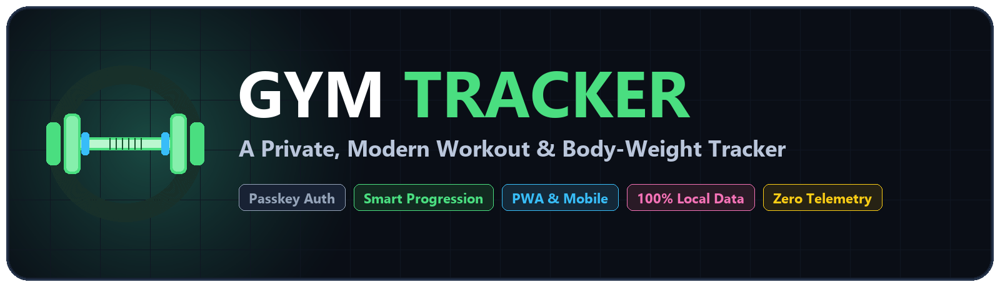
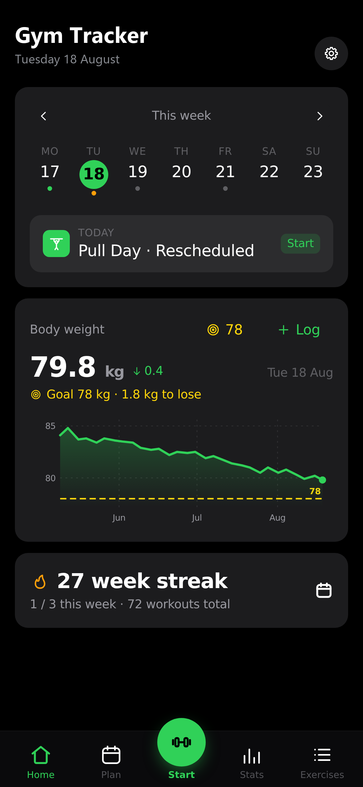
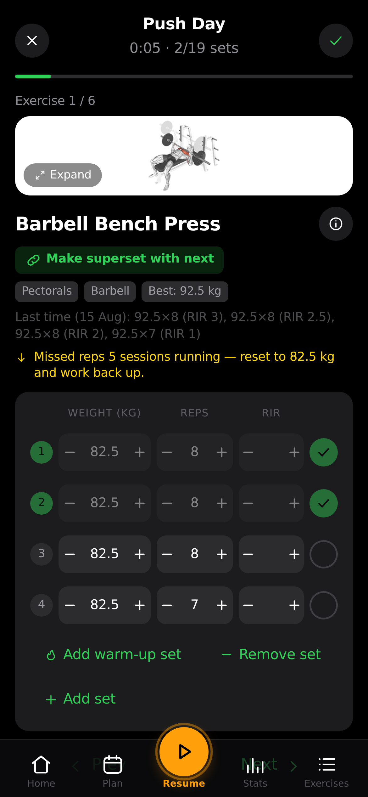
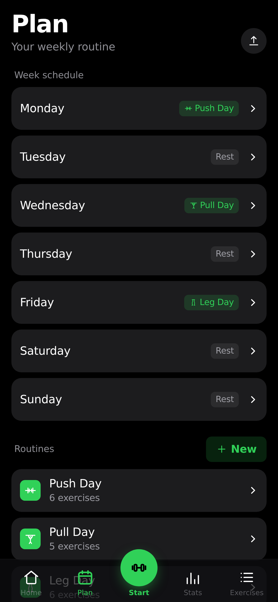
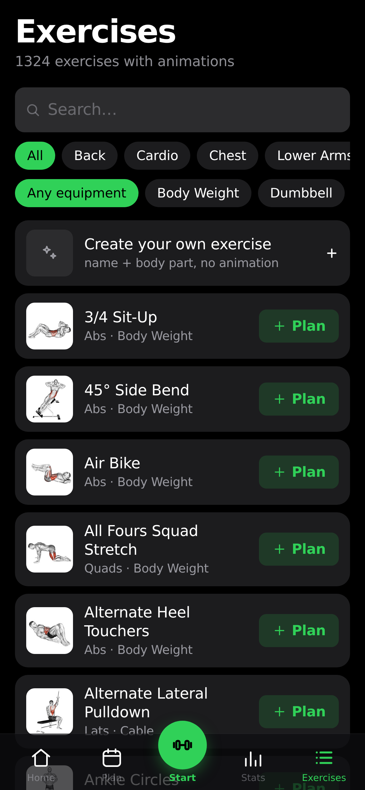
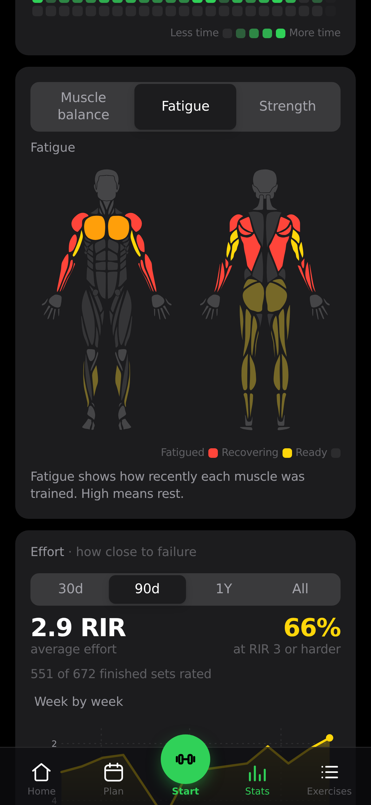

<div align="center">



<br>

# 🏋️ Gym Tracker

**A private, modern workout logger and body-weight tracker built for full data ownership.**

Plan weekly routines, execute structured guided workouts, master progressive overload, track fatigue and muscle recovery, and monitor body composition over time — seamlessly across your phone, tablet, and desktop.

<br>

[](LICENSE)


[](https://vercel.com)

<br>

**Support & Contact:** [arjunsonara1657@gmail.com](mailto:arjunsonara1657@gmail.com)

</div>

<br>

---

## 📱 Visual Showcase

<div align="center">
<table>
<tr>
<td align="center" width="20%">
  <br>
  <sub><b>Home Dashboard</b><br>Daily workout, weight logs & progress trajectory</sub>
</td>
<td align="center" width="20%">
  <br>
  <sub><b>Live Workout</b><br>Drop-sets, rest-pause, rest timer & animated guides</sub>
</td>
<td align="center" width="20%">
  <br>
  <sub><b>Routine Planner</b><br>Weekly splits, superset builder & progression rules</sub>
</td>
<td align="center" width="20%">
  <br>
  <sub><b>Exercise Library</b><br>1,300+ movements with muscle & gear filters</sub>
</td>
<td align="center" width="20%">
  <br>
  <sub><b>Analytics & Recovery</b><br>3-way muscle maps, 1RM curves & heatmap</sub>
</td>
</tr>
</table>
</div>

---

## 💡 Why Gym Tracker?

Most mainstream fitness applications lock your training logs behind expensive subscriptions, inject intrusive ads, harvest personal biometric data, or risk disappearing when a company pivots.

**Gym Tracker is built on a different philosophy:**
- 🛡️ **Total Data Ownership:** Your training history and body metrics live in plain JSON on your own system or local device storage.
- ⚡ **Zero Friction:** No tedious sign-up forms or forgotten passwords — authenticate instantly with biometric Passkeys (Face ID, Touch ID, Windows Hello).
- 🚀 **Zero Telemetry & Offline Ready:** No tracking scripts, no third-party analytics. Works completely offline as a Progressive Web App (PWA) or standalone mobile app.
- 🧠 **Science-Based Progression:** Automated progression engines (Linear, Greyskull LP, Double Progression), fatigue modeling, and 1RM estimations calculate your next targets automatically.

---

## 🌟 Key Features

### 🏋️ Guided Live Workouts
- **Smart History Prefill:** Automatically recalls your last completed reps and weights for every movement.
- **Active Rest & Work Timers:** Built-in rest interval counter with sound/vibration alerts, plus dedicated stopwatches for timed holds (planks, wall sits).
- **Screen Wake Lock:** Prevents your phone screen from dimming or locking during workout sessions.
- **Real-Time PR Detection:** Automatic notifications whenever you break an estimated 1RM, max weight, or rep record.
- **Dynamic Session Edits:** Add, reorder, swap, or remove exercises and sets on the fly without interrupting the workout flow.

### ⚡ Advanced Set Types & Intensifiers
- **Drop-Sets:** Plan multi-tier weight drops (e.g. 2 drops at -20% load) or attach drop rows live during training.
- **Rest-Pause / Myo-Reps:** Program activation sets followed by mini-burst clusters with short intra-set recovery windows (e.g. 12 reps decomposed into `[6, 3, 2, 1]` bursts).
- **Warm-Up Isolation:** Dedicated warm-up phase rows that won't skew your working-volume stats, fatigue calculations, or 1RM curves.
- **Supersets & Giant Sets:** Group exercises together with seamless back-to-back transitions and unified rest periods.
- **Bodyweight & Timed Exercises:** Native support for bodyweight movements with rep progression or weighted dip-belt additions, plus duration-based isometric tracking.

### 📈 Intelligent Progression Engine
- **Linear Progression:** Automatically increments weights by custom step amounts on successful target completions.
- **Greyskull LP:** AMRAP (As Many Reps As Possible) top-set progression with automatic stall detection and deload resets.
- **Double Progression:** Progress repetitions within a target rep bracket before stepping up load.
- **Time-Based Overload:** Add duration targets for static holds and carries.

### 🧠 Muscle Analytics & Recovery Modeling
- **3-Way Muscle Diagrams:**
  - **Volume Balance:** Visual front-and-back heatmap of muscle group load distribution over weeks or months.
  - **Fatigue Map:** Smooth physiological recovery decay model tracking worked muscle fatigue in real time.
  - **Strength Progression:** Highlights when each muscle was last stimulated and links to your personal 1RM records.
- **Estimated 1RM Curves:** Powered by validated Epley/Brzycki formulas across your top eligible sets.
- **RPE & RIR Scoring:** Optional Rate of Perceived Exertion (1–10) and Reps in Reserve logging per set.
- **Consistency Heatmap:** GitHub-style yearly workout frequency matrix.

### 📚 Extensive Exercise Library & Customization
- **1,300+ Exercise Database:** Searchable with animated execution demonstrations, target muscles, and equipment requirements.
- **Equipment Filtering:** Filter routines and movements by available gear (barbells, dumbbells, cables, machines, bodyweight).
- **Custom Movements:** Create custom exercises with dedicated muscle tagging and technique instructions.

### 🔐 Privacy & Biometric Authentication
- **Passkey (WebAuthn) Sign-In:** Secure, passwordless authentication using Face ID, Touch ID, or security keys.
- **Zero Cloud Dependence:** Run completely local, deploy on your own server, or run in guest mode with zero backend required.
- **No Third-Party Analytics:** Absolutely zero user tracking, trackers, or remote telemetry.

### 🔄 Data Freedom & Migration
- **Universal CSV Importer:** Migrate full training histories seamlessly from **Strong**, **Hevy**, **FitNotes** (Android & iOS), and **Apple Health**.
- **One-Click JSON Backups:** Complete export and import of your routines, history, body weight, and settings.
- **Shareable Plans:** Export routine presets as lightweight JSON or clean printable PDFs.

### 🤖 Local AI Assistant Integration (MCP)
- Built-in **Model Context Protocol (MCP)** server enabling AI tools (like Claude Desktop or Cursor) to read your local workout history, analyze recovery, and answer training queries over stdio.

### 🌍 Internationalization
- Fully translated UI available in 13+ languages (English, German, Spanish, French, Italian, Portuguese, Polish, Turkish, Russian, Chinese, Korean, Hindi, and more).

---

## 🏗️ Architecture Overview

Gym Tracker uses a lightweight, decoupled architecture designed for speed, privacy, and minimal resource overhead:

```
┌─────────────────────────────────────────────────────────────┐
│                    Client Devices                           │
│     Mobile App (Capacitor)  │  Browser PWA  │  Desktop      │
└──────────────────────────────┬──────────────────────────────┘
                               │ HTTPS / Localhost
                               ▼
┌─────────────────────────────────────────────────────────────┐
│                   Web Layer (Nginx / Vercel)                │
│    - Serves compiled React 19 + Vite static assets          │
│    - Proxies /api routes to backend on unified origin       │
└──────────────────────────────┬──────────────────────────────┘
                               │
                               ▼
┌─────────────────────────────────────────────────────────────┐
│                   API Layer (Node.js)                       │
│    - Zero-framework lightweight HTTP server                 │
│    - WebAuthn / Passkey authentication & session cookies    │
│    - Web-Push background notification triggers              │
└──────────────────────────────┬──────────────────────────────┘
                               │
                               ▼
┌─────────────────────────────────────────────────────────────┐
│                   Storage Layer (./data)                    │
│    - db.json (User profiles & public credentials)           │
│    - state-<uid>.json (Workout history, routines, weight)   │
│    - audit.log & session secrets (Atomic file writes)       │
└─────────────────────────────────────────────────────────────┘
```

---

## 🚀 Quick Start & Deployment

Choose the setup method that best suits your workflow:

### Option 1: Self-Host with Docker Compose (Recommended for Multi-Device Sync)

Requirements: [Docker](https://docs.docker.com/get-docker/) with Compose.

```bash
# 1. Clone the repository
git clone https://github.com/ArjunSonara/Gym-Tracker.git
cd Gym-Tracker

# 2. Copy environment template
cp .env.example .env

# 3. Build and launch containers
docker compose up -d --build
```

- Open **`http://localhost:8080`** in your browser.
- Create your profile with a biometric passkey and start tracking!
- *For remote access over the internet via custom domain and HTTPS, see [docs/SELF_HOSTING.md](docs/SELF_HOSTING.md).*

---

### Option 2: 1-Click Standalone Deployment on Vercel

Run Gym Tracker as a fast, client-side web application with local storage persistence:

1. Fork or push this repository to your GitHub account.
2. Log into the [Vercel Dashboard](https://vercel.com) and click **Add New Project**.
3. Select your repository and configure:
   - **Framework Preset:** `Vite`
   - **Root Directory:** `frontend`
4. Click **Deploy**!

---

### Option 3: Local Frontend Development

Requirements: Node.js (v18+) and npm.

```bash
# Navigate to frontend directory
cd frontend

# Install dependencies
npm install

# Start Vite hot-reloading dev server
npm run dev
```

Open `http://localhost:5173` in your browser.

To run the unit test suite (verifying progression algorithms, 1RM formulas, and intensifier logic):
```bash
npm test
```

---

### Option 4: Standalone Mobile App (Android APK & iOS)

Build a native mobile version using Capacitor that stores all data locally in the device's private storage:

```bash
cd frontend
npm install

# Build static bundle and sync Capacitor assets
npm run build:mobile

# Open in Android Studio or Xcode
npx cap open android   # Build sideloadable APK
npx cap open ios       # Open Xcode workspace (macOS)
```

*For detailed instructions on mobile builds and pairing, see [docs/MOBILE.md](docs/MOBILE.md).*

---

## ⚙️ Configuration Reference

All backend configurations are managed through `.env`. Below are the primary environment variables:

| Variable | Description | Default |
|:---|:---|:---|
| `RP_ID` | Hostname passkeys are bound to (e.g. `localhost` or `gym.yourdomain.com`) | `localhost` |
| `ORIGIN` | Full public origin URL the app is accessed from | `http://localhost:8080` |
| `WEB_PORT` | Host port mapped to the web interface | `8080` |
| `PORT` | Port the internal Node API listens on | `3000` |
| `RP_NAME` | Display name shown during WebAuthn passkey prompts | `Gym Tracker` |
| `SESSION_DAYS` | Validity period for signed authentication sessions | `90` |
| `ALLOW_GUEST` | Allow browser-only guest usage without account creation (`1` = On, `0` = Off) | `1` |
| `INVITE_ONLY` | Require an invitation code to register new profiles | `0` |
| `ADMIN_UIDS` | Comma-separated user IDs granted access to the admin panel | *(none)* |
| `AUDIT_LOG` | Enable security and login event logging | `1` |
| `AUDIT_IP` | Record incoming request IP address (`off`, `net`, or `full`) | `off` |

---

## 📥 Migrating from Other Trackers

Gym Tracker supports importing your existing workout history via CSV files from:
- **Strong** (Settings → Export Data)
- **Hevy** (Profile → Settings → Export Workouts / Measurements)
- **FitNotes** for Android & iOS (Spreadsheet CSV export)
- **Apple Health** (Body weight exports)

Exercise names are automatically matched against our 1,300+ library. Any custom or unmapped exercises are automatically created in your personal library so no data is ever lost. See [docs/DATA_IMPORTS.md](docs/DATA_IMPORTS.md) for full specifications.

---

## 🗺️ Roadmap

- [x] Full-featured guided workout logging & live timers
- [x] Advanced Drop-Sets and Rest-Pause (Myo-Reps) intensifier planning
- [x] Algorithmic progression models (Linear, Greyskull LP, Double Progression)
- [x] 3-Way Muscle Recovery, Fatigue decay, and Volume Balance maps
- [x] Universal CSV Importers (Strong, Hevy, FitNotes, Apple Health)
- [x] Standalone Capacitor mobile builds (Android & iOS)
- [x] Local MCP Server for AI workout history analysis
- [ ] Percentage-based programming & training-max cycles (5/3/1 support)
- [ ] Visual barbell plate loading calculator
- [ ] Body circumference metric tracking (chest, waist, arms) alongside weight

---

## 🤝 Contributing

Contributions, feedback, and bug reports are welcome!

1. Fork the repository
2. Create your feature branch (`git checkout -b feature/amazing-feature`)
3. Ensure training logic tests pass (`npm test` in `frontend/`)
4. Commit your changes (`git commit -m 'Add amazing feature'`)
5. Push to the branch (`git push origin feature/amazing-feature`)
6. Open a Pull Request

---

## 📄 License & Attributions

- **Codebase:** Distributed under the **[MIT License](LICENSE)**.
- **Exercise Dataset:** Exercise metadata and technique descriptions are provided via [hasaneyldrm/exercises-dataset](https://github.com/hasaneyldrm/exercises-dataset) under the MIT License.
- **Third-Party Notices:** See [NOTICE.md](NOTICE.md) for geometry and dataset attribution details.

---

## 📬 Support & Contact

If you have questions, encounter an issue, or want to suggest a feature:

- **Author & Maintainer:** Arjun Sonara
- **Email:** [arjunsonara1657@gmail.com](mailto:arjunsonara1657@gmail.com)
- **Repository:** [GitHub - ArjunSonara/Gym-Tracker](https://github.com/ArjunSonara/Gym-Tracker)
